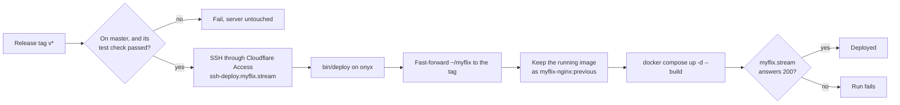

# Myflix

A React front end for a personal movie and TV collection, served at [myflix.stream](https://myflix.stream). Its data comes from MMDb's API.

The client lives in `frontend/client` (Vite, React, Vitest). `frontend/Dockerfile` builds it into an nginx image, and `docker-compose.yml` runs that image on port 7666, which a Cloudflare tunnel serves as myflix.stream.

## Developing

On Node 24 (`frontend/client/.nvmrc`):

```sh
cd frontend/client
yarn install
yarn start   # dev server on localhost:3000, the port MMDb's CORS settings allow
yarn test
```

Changes go through OpenSpec (`openspec/`) and a pull request. `master` requires the `test` check, which runs the tests, builds the client and its Docker image, and lints the workflows.

## Releasing

Publish a GitHub release with a new tag in the form `vYYYY.MM.DD`, or `vYYYY.MM.DD.N` for a second release that day, on `master`. Use the web UI: the tag ruleset rejects a `v*` tag pushed with git.

The `Deploy` workflow then:



- It waits for a `test` check still running, for about 15 minutes.
- Only one deploy runs at a time; another waits for it.
- The deploy key can only run `bin/deploy`, and `bin/deploy` only moves the server forward to a tag on `master`. It refuses a malformed request, a dirty checkout, a moved tag and a tag behind the server.
- A failed run can be retried with "Re-run jobs": deploying the tag the server is already on rebuilds and checks it again.
- A deploy runs the `bin/deploy` the server had before it, so a release that changes `bin/deploy` and depends on the change is deployed twice.

## Rolling back

Each deploy of a new tag keeps the image it replaced as `myflix-nginx:previous`; retrying the same tag leaves it alone. To restore it without a build:

```sh
ssh onyx@192.168.40.63
cd ~/myflix
docker tag myflix-nginx:previous myflix-nginx:latest
docker compose up -d --no-build
```

The checkout stays at the newer tag, so the next release deploys normally. To undo a release for good, revert it on `master` and release again.

## Deploying by hand

If the workflow or the tunnel is down, deploy from a checkout of `master` on the LAN:

```sh
ssh onyx@192.168.40.63 'cd ~/myflix && git pull --ff-only && docker tag myflix-nginx:latest myflix-nginx:previous && docker compose up -d --build'
```
